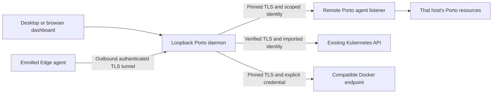

# Authenticated environments and Edge fleets

Porto stays local-first. The dashboard and existing control API remain on
loopback, local Docker contexts retain their existing endpoints, and no hosted
account is needed. Remote management is an explicit opt-in using a separate,
authenticated TLS listener, not a network binding of the unauthenticated API.

## Topology and trust

The dashboard's **Environment** selector identifies one target by its immutable
Porto environment ID. It does not change global Docker contexts, shell
configuration, global kubeconfigs, or the meaning of ordinary local CLI
commands. Use `porto environments request ENVIRONMENT_ID ...` for explicit
headless remote access.



Porto generates separate, independently revocable client and Edge identities.
Enrollment secrets are single-use, valid for 60-900 seconds, and grant only the
capabilities chosen by the issuing host. The default CLI validity is five
minutes. Issued credentials expire after 30 days. Rotation invalidates the old
client credential and terminates its existing streams.

Porto agent protocol **1** requires TLS **1.3** and the exact server certificate
obtained through a trusted channel. Normal certificate validity and hostname
checks still apply. There is no trust-on-first-use, insecure retry, redirect
following, cookie forwarding, or substitution of another identity. Generated
listener certificates last one year. To replace a listener identity, stop it,
verify the replacement certificate, and explicitly enroll fresh identities.

Tokens, client private keys, imported kubeconfig identity data, and the listener
private key are stored in the OS credential store. Large values use bounded
native records with an atomic generation pointer, including on Windows
Credential Manager. Record names use random generation IDs, not secret-derived
fingerprints. Identity payloads are limited to 256 KiB after serialization;
there is no plaintext file fallback. Metadata, certificate pins and hashed
server-side token verifiers live under `PORTO_HOME/environments`.

The OS credential store must be available and unlocked. A headless Linux service
needs an accessible Secret Service session; a missing or locked vault is an
onboarding error, not permission to write credentials into configuration files.

## Enroll a remote Porto host

Start Porto on the source host. Desktop installations already start their
daemon; headless installations use `porto daemon start`.

On that host, explicitly enable the narrow TLS listener:

```sh
porto environments listen \
  --listen 0.0.0.0:37624 \
  --hostname porto-host.example \
  --public-address https://porto-host.example:37624
porto environments listener
porto environments enroll \
  --name workstation \
  --kind client \
  --capabilities inventory.read,workload.operate,streams.read,terminal.open \
  --ttl 300
```

`porto agent serve` is an alias for the listener command. Restrict its network
exposure with the host firewall. Never forward the existing unauthenticated
loopback API as an alternative.

Transfer the enrollment token and verify the public server certificate out of
band. In the controlling dashboard, open **Environments and fleets > Register**
and select **Authenticated Porto agent**. Alternatively, prepare an owner-only
JSON file, replacing the placeholders:

```json
{
  "name": "Development host",
  "backend": "porto",
  "address": "https://porto-host.example:37624",
  "certificate": "<verified PEM server certificate>",
  "enrollmentToken": "<single-use token>",
  "labels": { "group": "development", "location": "lab" }
}
```

```sh
porto environments add connection.json
porto environments list
porto environments request ENVIRONMENT_ID GET /api/docker/containers/snapshot
```

Delete the temporary credential-bearing onboarding file after success. A profile
cannot locally elevate the capabilities assigned by its remote enrollment.
Names and labels are descriptive, not authorization. Re-register an environment
to change its endpoint or identity; an existing ID is never silently retargeted.
Use **Edit labels** for descriptive name/group changes, including enrolled Edge
targets. Headless edits use `porto environments metadata ID metadata.json` with
`{name, labels, revision}` from the current profile. Concurrent changes fail
instead of overwriting another edit, and old fleet previews need review again.

| Capability | Authority |
| --- | --- |
| `inventory.read` | Supported inventory and status APIs, excluding sensitive raw inspections |
| `workload.operate` | Supported workload lifecycle and application delivery actions |
| `streams.read` | Target-owned logs and lifecycle streams |
| `terminal.open` | Explicit container, pod, VM or image-inspection sessions |
| `infrastructure.operate` | Supported lifecycle actions on infrastructure owned by that Porto host |
| `secrets.read` | Sensitive raw container/image inspection and explicitly requested Kubernetes/definition reveals |

These are powerful operator grants, not enterprise RBAC. Runtime control,
terminals and infrastructure actions can execute code or disrupt workloads.
Logs and workload configuration can themselves contain sensitive application
data. Grant capabilities only to identities you trust with those effects.

## Outbound Edge connectivity

Enable the secure listener on the controlling Porto host, reachable by the Edge
host. On the controller, create an **Edge** enrollment in the dashboard or:

```sh
porto environments enroll \
  --name lab-edge \
  --kind edge \
  --capabilities inventory.read,workload.operate,streams.read,terminal.open \
  --ttl 300 > /private/path/edge-enrollment.json
```

Transfer that file securely and verify its embedded server certificate. On the
enrolled host, with its compatible local Porto daemon running:

```sh
porto agent connect --enrollment /private/path/edge-enrollment.json
```

The agent opens an outbound TLS/WebSocket connection; it opens no inbound port.
Independent multiplexed HTTP connections carry concurrent inventory, actions,
logs and terminal upgrades. The controller creates the Edge environment only
after explicit enrollment. Client enrollments cannot be used as Edge enrollments
or vice versa.

Delete the one-time file after successful enrollment. Subsequent runs use the
saved, OS-vault-backed identity:

```sh
porto agent connect
```

Keep it in the foreground or run it with your service manager using the same
user, `PORTO_HOME`, and unlocked credential store. Reconnect delay grows from one
to at most 30 seconds; heartbeat checks run every ten seconds. An outage marks
the target offline and closes active streams. Reconnection restores transport,
not queued mutations. A revoked or expired identity stops reconnecting until
explicit re-enrollment.

`Ctrl+C` disconnects the agent without deleting workload data. To forget a stopped
agent, revoke its identity on the controller and remove its local credential:

```sh
porto environments revoke-identity --confirm IDENTITY_ID
# On the Edge host:
porto agent forget --confirm
```

If remote revocation was already performed or cannot be confirmed from that
host, `porto agent forget --confirm --local-only` explicitly forgets local
identity state without claiming issuer-side revocation.

## External Kubernetes import

Import only a context explicitly selected from supplied kubeconfig content.
Registration never adopts its infrastructure or rewrites an unrelated/global
kubeconfig. Use the dashboard import form or an owner-only profile file:

```json
{
  "name": "Existing test cluster",
  "backend": "kubernetes",
  "context": "team-test",
  "kubeconfig": "<explicit kubeconfig contents, not a filename>",
  "operate": false,
  "capabilities": [],
  "labels": { "group": "testing" }
}
```

The selected context is minified and stored in the OS vault. Verified HTTPS,
inline identity material and an explicit bearer token or client certificate/key
are required. Inline CA data or the system trust roots verify the server.
Insecure TLS, credential/CA file references, executable/auth-provider plugins,
basic authentication, kubeconfig proxy URLs and impersonation are rejected.
Input kubeconfig content is limited to 1 MiB.

The imported environment exposes **Resources and RBAC**, **Helm**, resource
inspection and authorized pod logs. `operate: true` separately permits workload
operations; native Kubernetes RBAC remains authoritative. Optional
`capabilities: ["terminal.open", "secrets.read"]` must be explicitly requested
for pod terminals or sensitive inspection. Pod logs/terminals verify the selected
UID before opening, and disconnect/revocation cancels the stream. Imported pod
terminals use client-go's authenticated WebSocket/SPDY transport, without
writing a credential-bearing terminal kubeconfig.

The existing scoped Helm controller retains its own protected temporary
command-identity handling. Removing an import cancels owned administration jobs,
deletes that environment's local administration state and vault records, and
never deletes cluster infrastructure, workloads, namespaces or persistent data.
Powerful native RBAC permissions remain powerful; import is not a replacement
for a suitably scoped cluster identity.

The native client-go version is **1.37.1**; bundled `kubectl` is **1.36.1**. Follow Kubernetes'
supported client/server version skew and use API discovery to check served
resources. Registering a connection is not a claim that every optional API,
chart, controller or unsupported server version works.

## Compatible container endpoints

Choose **Compatible Docker TLS endpoint**, provide its verified server
certificate, and explicitly supply a bearer credential or client certificate/key.
Unauthenticated HTTP/TCP endpoints and inherited Docker contexts are not used.
`operate: true` enables the adapter's container lifecycle actions; an explicit
`secrets.read` grant is needed for raw sensitive inspection.

The adapter negotiates Docker API **1.41-1.47**. It supports container inventory,
immutable identity/inspection, bounded logs, and explicit existing-container
start/stop/restart/pause/unpause/kill/remove actions. Event snapshots are polled,
not advertised as native containerd lifecycle events. Removal retains volumes.
It does not offer a Docker Extensions API or full Docker Engine compatibility.

| Surface | Local Porto | Porto/Edge agent | Compatible Docker endpoint | Imported Kubernetes |
| --- | --- | --- | --- | --- |
| Project lifecycle, delivery, logs | Existing behavior | Authorized supported APIs | Not exposed | Not exposed |
| Containers/images/networks/volumes | Existing behavior | Authorized supported APIs | Container adapter subset only | Not exposed |
| Native Kubernetes/Helm administration | Managed identities | Authorized host identities | Not exposed | Explicit imported identity |
| Terminals | Existing behavior | Explicit terminal grant | Not exposed | Explicit pod-terminal grant |
| Owned VM/cluster provisioning | Existing behavior | Explicit infrastructure grant | Not exposed | Never conferred by import |
| Host setup, branch mutation, native files, migration, scanner lifecycle | Existing behavior | Not exposed by agent protocol 1 | Not exposed | Not exposed |

Unsupported features return errors rather than becoming successful connection
checks. A reachable `/version` endpoint does not imply support for builds,
storage automation, mounts, Swarm, plugins, native Windows mode switching or
other omitted operations. See the [local Docker compatibility matrix](docker-engine.md#docker-api-compatibility-matrix).

Source-host loopback workload URLs are displayed as **source host only** and are
not opened as same-named local workloads. Use a deliberately configured remote
port forward or externally reachable ingress. Porto does not serve arbitrary
workload HTML under its privileged dashboard origin.

## Fleet operations, offline state and recovery

Every proxied API path contains an environment ID:
`/api/environments/ID/api/...`. Inventory caches, terminal connections, activity
history, event cursors, operation references and imported administration stores
are target-scoped. Changing targets remounts resource views and closes their
streams. UI/desktop appearance preferences remain local.

The fleet form accepts 1-32 explicitly selected containers. Preview resolves
immutable container IDs and records each environment revision, so same names on
different hosts cannot collide. Confirm the exact action/target count within two
minutes. Up to four targets run concurrently, with independent results and
explicit cancellation. A changed identity, expired preview, conflicting fleet
action or offline target fails instead of retargeting or retrying.

```sh
porto environments fleet-preview targets.json
porto environments fleet-run --confirmation 'stop 2 targets' PREVIEW_ID
porto environments fleet-list
porto environments fleet-status RUN_ID
porto environments fleet-cancel RUN_ID
```

The preview file shape is:

```json
{
  "action": "stop",
  "targets": [
    { "environmentId": "<first ID>", "resourceId": "same-name" },
    { "environmentId": "<second ID>", "resourceId": "same-name" }
  ]
}
```

Offline actions are not queued. Cancellation is not rollback: a request already
dispatched to a host may have taken effect, and a previously admitted native
asynchronous operation can continue there. Inspect exact per-target state before
an explicit retry. Interrupted operation history never implies success.

```sh
porto environments rotate ENVIRONMENT_ID
porto environments revoke --confirm ENVIRONMENT_ID
porto environments remove --confirm ENVIRONMENT_ID
porto environments stop-listener --confirm
```

Rotation is available for active Porto client identities. Rotate Edge identities
by revoking and explicitly enrolling a replacement. Re-import externally issued
Docker/Kubernetes credentials through a new profile; Porto does not revoke a
shared external identity at its issuer. An unreachable Porto host leaves remote
revocation unconfirmed while blocking access locally. Confirm revocation on the
source host, or explicitly choose `remove --confirm --local-only` to forget only
the local copy. Stopping the secure listener revokes its client/Edge identities
without deleting workload data.

If TLS trust, vault access, enrollment or connectivity fails, repair that exact
target. Do not select an unrelated kubeconfig, disable certificate validation,
reuse a consumed enrollment, or point an existing ID at another machine.

## API summary

The loopback management API uses JSON with unknown fields and extra JSON values
rejected. Errors include `code` and `message`; statuses distinguish invalid input
(400), unauthenticated/revoked access (401), denied scope (403), missing targets
(404), identity/preview conflicts (409), capacity limits (429), unsupported
features (501) and unavailable targets (503).

| Method and path | Request / result |
| --- | --- |
| `GET /api/environments` | Local and enrolled metadata; no credentials |
| `POST /api/environments` | Profile fields shown above; 201 registered profile |
| `DELETE /api/environments/ID` | Remove local profile/owned credentials; `localOnly=true` explicitly bypasses unconfirmed Porto revocation |
| `POST .../ID/rotation` / `.../ID/revocation` | Rotate or revoke that exact identity |
| `PUT .../ID/metadata` | `{name, labels, revision}`; descriptive edits only, never identity/capability changes |
| `GET` / `POST` / `DELETE /api/environments/listener` | Inspect, explicitly enable, or stop/revoke the secure listener |
| `POST /api/environments/enrollments` | `{name, kind, capabilities, ttlSeconds}`; one-time token, expiry and public connection information |
| `GET /api/environments/identities` / `DELETE .../identities/ID` | Inspect or revoke issuer-owned identities |
| `/api/environments/ID/api/...` | Capability-checked target API/stream; no fallback or redirects |
| `POST /api/environments/fleet/previews` | `{action, targets}`; immutable target preview and confirmation |
| `POST /api/environments/fleet/runs` | `{preview, confirmation}`; 202 run with operation ID and per-target results |
| `GET .../fleet/runs` / `GET .../fleet/runs/ID` / `POST .../fleet/runs/ID/cancel` | Recover results and explicitly cancel |

The separate TLS listener accepts `POST /v1/enroll` with `{token, kind}`,
authenticated `POST /v1/identity/rotate` and `/revoke`,
`GET /v1/edge/connect`, and the allowlisted `/v1/api` prefix in front of core
`/api/...` paths. Client/Edge authentication uses `Authorization: Bearer TOKEN`.
Browser-origin requests are refused on that listener. It accepts at most 64
connections and 32 active agent requests, with 16 streams per Edge tunnel,
5-second header and 30-second request-body deadlines. API requests are limited
to 16 MiB; authorized agent streams have a 30-minute request lifetime.
